# trading_bot_v0.2
Помощник для решений с акциями на московской бирже

**Орбита** — сайт-дашборд в стиле космического минимализма с асинхронным
бэкэнд-сканером всех акций MOEX (режим TQBR), пуш-уведомлениями через браузер
(PWA + service worker + VAPID), анти-памп фильтром, детектором «плиты»,
журналом «почему молчит» и paper trading. Один процесс asyncio: сканер +
планировщик запросов + FastAPI/uvicorn + SQLite.


📘 **[Руководство пользователя и учебник по торговле со сканером](docs/GUIDE.md)** —
все функции и характеристики акций, суть каждого триггера, порядок торгового
дня со сканером, справочник настроек.

## Быстрый старт

```bash
python -m venv .venv && . .venv/bin/activate      # Windows: .venv\Scripts\activate
pip install -r requirements.txt
python start.py
```

Скрипт поднимает всё сразу — сайт, сканер, планировщик и БД — и печатает:

```
================================================================
  Дашборд:      http://127.0.0.1:8000
  Ключ админа:  admin-XXXX-XXXX-XXXX-XXXX  (создан сейчас)
  Файл ключа:   config/admin_key.txt
  База:         data/trading_bot.sqlite3
  Пуши (VAPID): готовы
  Сканер MOEX:  включён, 1 запрос/с
  Остановка:    введите 0 и Enter (или Ctrl+C)
================================================================
```

* Откройте адрес дашборда и войдите **ключом админа**.
* **Остановка** — ввести `0` и Enter в консоли (или Ctrl+C, или кнопка
  «Остановить сервер» в админке).

Нужен Python 3.10+.

### Демо без биржи

```bash
python examples/demo_server.py      # http://127.0.0.1:8000, остановка — «0»
```

Демо прогоняет настоящий конвейер сканера на детерминированных синтетических
данных (это **не** реальные котировки): неделя минутных свечей по 14 бумагам,
импульсы вверх/вниз, плита, «поздний» рост как у ETLN из issue. Демо-база и ключ
лежат отдельно — `data-demo/` и `config-demo/`. Все скриншоты ниже сняты с демо.

`python examples/etln_verdict.py` воспроизводит тест-кейс ETLN из п. 16: старый
скоринг говорит «ПОКУПАТЬ», а с фильтром выходит «ПОЗДНО, ЖДАТЬ ОТКАТ».

## Доступ: ключи-пароли

* **Админ** входит ключом из файла `config/admin_key.txt`. Если файла нет, при
  первом запуске он создаётся со случайным ключом. Ключ можно заменить вручную
  (первая непустая строка файла) — подхватится после перезапуска.
* Во вкладке **«Админ»** админ генерирует ключи для пользователей, меняет
  метку, **деактивирует/активирует** и удаляет их.
  * Деактивация сразу гасит сессии пользователя.
  * Ключ админа отключить нельзя.
* Ключи хранятся только как хэш (SHA-256) в таблице `access_keys`: роль,
  статус, подсказка (последние 4 символа), время последнего входа.
  Полный ключ показывается один раз — при создании.
* Пользователь вводит свой ключ на странице входа и попадает в личный кабинет.
  Сессия — httpOnly cookie на 30 дней.

## Что умеет

| Вкладка | Что внутри |
|---|---|
| **Рынок** | Таблица всех акций: цена, изменение дня, амплитуда/ATR, объём к среднему, изменение за час, пробой уровня, возраст импульса, признаки плиты, RSI и др. Набор колонок настраивается; сортировка — по близости к порогу. Кнопки «Анализ акции», «Анализ нескольких», «Избранное», «Топ-10 голубых фишек», «Пульсирующие 1–5%» — замена старого CLI-меню; они ставят задачу в очередь с приоритетом P0. |
| **Карточка тикера** | Все метрики и P0-анализ: вердикт, сила сигнала (не вероятность), стоп/тейк, R/R, зоны, RSI, SMA20/50, MACD, Боллинджер, стохастик, ATR, пивоты, недельный тренд, стакан. Графики: свечи+объём+Боллинджер, ATR, RSI 30/70, MACD, стохастик K/D, амплитуда/ATR, volume_ratio, возраст импульса, расстояние до порога. |
| **Сигналы** | История сигналов: время, тикер, направление, причина в цифрах, сила, действие. |
| **Отчёт дня** | Топ-3 вверх и вниз с причинами и метриками; пуш в 19:00 МСК (время настраивается); отраслевой/массовый снос. |
| **Почему молчит** | Журнал решений по каждому тикеру за цикл: какое условие не прошло и сколько не хватило, сортировка по близости к порогу. |
| **Paper** | Виртуальные входы по алерту: цена, стоп, тейк, автозакрытие по стопу/тейку, статистика. |
| **Метрики** | Планировщик: очередь P0/P1/P2, запросов/с, среднее время ответа, 429 за час, отставание P1. Плюс графики метрик по всем тикерам. |
| **Настройки** | Пороги сигнала, памп-фильтр, плита, риск, уведомления, формат пуша, колонки и графики. Подписка устройства на пуши. |
| **Админ** | Ключи пользователей, глобальные настройки (интервал цикла и т. п.), тестовый пуш с таймером (по умолчанию 1 с), запуск цикла, остановка сервера. |

### Сканер и планировщик (п. 1, 17, 21, 27)

* **Обход всех бумаг TQBR** с ценой. Один на весь процесс token bucket —
  1 запрос/с (`TB_RPS`), через него идут все запросы к ISS.
* **Одна `asyncio.PriorityQueue`** на три уровня:
  * **P0** — детали по сработавшему тикеру и по кнопкам: дневные свечи,
    индикаторы, стакан;
  * **P1** — хвост минутных свечей по всем бумагам (`from=<последняя свеча>`);
  * **P2** — фон: дневной ATR, отчёт.

  Пока в очереди есть P0, P1 и P2 ждут.
* **Батчинг:** список бумаг и котировки — одним запросом на всю доску; индекс —
  отдельным запросом.
* **Retry/backoff** на 429, 5xx и сетевые ошибки: задача возвращается в очередь
  с тем же приоритетом.
* **TTL-кэш:** свечи — до следующей свечи, список бумаг — сутки, индекс — минута.
* **Интервал цикла** задаёт админ, минимум 15 минут.
* **Индикаторы** (RSI, MACD, Боллинджер, стохастик, пивоты) считаются только на
  P0 — для тикера, прошедшего триггер.
* **Стакан** запрашивается только на P0. Без платной подписки ISS отдаёт HTML
  вместо стакана — сканер это видит и больше стакан не запрашивает. Плита
  детектируется по свечам и объёму.
* **Холодный старт:** если сервер запущен до открытия сессии, сканер берёт
  прошлую сессию (`PREVDATE`), чтобы таблица не была пустой.

### Сигнал, фильтры, уведомления (п. 6, 7, 10, 11, 13, 15, 18, 22–25)

* **Пороги нормированы на ATR** (п. 13). Амплитуда — это `амплитуда свечи / ATR`,
  с диапазоном min…max. Плюс объёмный множитель и пробой локального уровня за
  окно.
* **Анти-памп — связка из четырёх признаков:**
  1. рост за час > k×ATR;
  2. RSI > 70;
  3. цена выше верхней полосы Боллинджера;
  4. аномальный объём.

  Два признака из четырёх — метка «перегрето», три — пуш на покупку глушится.
  Отдельно задаются «длина импульса» и «порог одиночного рывка» (п. 7).
  Бумаги, выросшие за час больше X%, исключаются (п. 10).
* **Детектор плиты** (п. 22). Четыре признака:
  1. N свечей подряд в одну сторону;
  2. откаты внутри серии меньше m% пройденного пути (обязательный признак);
  3. объём каждой свечи > k×среднего;
  4. ход > k₂×ATR.

  Три признака из четырёх — «плита», четыре — уверенный сигнал. Признаки и
  минимум настраиваются — см. «Доработка 1» ниже.
  * **Плита вверх** → «не входить / фиксировать».
  * **Плита вниз** → «кандидат на откуп».
  * **Массовый снос:** 5+ бумаг в одну сторону в одном окне.
* **Возраст импульса** (п. 25) — `impulse_age_min`. Импульс старше порога
  получает метку «поздно, ждать откат», пуш на вход не уходит.
* **Единый alert-объект** (п. 18): `ticker, ts, direction, score, amplitude_atr,
  volume_ratio, level_break, impulse_age_min, reason`. Из него собираются пуш,
  строка истории и дневной топ-3.
  * Типы алертов: `up_pulse`, `down_pulse`, `up_plate`, `down_plate`,
    `sector_dump` — пользователь выбирает, какие получать.
  * Формат пуша — шаблон с подстановками (`{ticker}`, `{reason}`, `{score}`,
    `{amplitude_atr}` …) с предпросмотром. Пользователь задаёт свой, админ — по
    умолчанию для всех.
* **Анти-спам:** кулдаун на тикер (30 мин), лимит пушей в день, тихие часы.
* **«Сила сигнала»** везде подписана как сила в текущих условиях, а не
  вероятность.

### Доработка 1 (issue #3)

**Расписание и прогрев**

* **Часы торгов** (п. 1). С 23:50 до 07:00 МСК сканер не ходит в ISS и показывает
  «пауза: биржа закрыта · до 07:00». Админ задаёт часы в настройках:
  `market_hours_only`, `market_open`, `market_close`; выходные пропускаются
  опционально (`skip_weekends`). Кнопка «Обновить сейчас» запускает цикл и
  ночью.
* **Прогрев** (п. 2). Первый цикл после запуска или после перерыва дольше
  `warmup_gap_min` (по умолчанию 45 мин, не меньше 2 интервалов цикла) не шлёт
  пушей. В такой цикл догружается весь пропущенный хвост свечей, и старые
  импульсы выглядели бы новыми. Алерты этого цикла сохраняются с пометкой
  «прогрев…» в истории. Выключается флагом `warmup_enabled`.
* **Скользящий срок хранения** (п. 3). Свечи, метрики, журнал решений, алерты и
  отчёты старше `retention_days` (по умолчанию 7) удаляются раз в сутки.
  Кнопка «Очистить сейчас» в админке делает это сразу.

**Графики** (п. 4)

* В карточке тикера есть периоды 1, 3, 7, 14 дней и «месяц».
* Для 14 и 30 дней берутся часовые свечи: локальные, если их хватает, иначе
  один запрос в ISS с приоритетом P0. Если ISS недоступен, график строится по
  локальной истории с пометкой.
* Длинная серия на телефоне прокручивается по горизонтали. Графики
  синхронизированы: прокрутка одного двигает остальные.

**Плита: четыре признака** (п. 5, 19)

Каждый признак включается отдельно в группе настроек «Плита»:

| Признак | Что проверяет | Настройки |
|---|---|---|
| Серия | N свечей окна подряд в одну сторону, **или** одиночный рывок телом ≥ k×ATR | `plate_use_series`, `plate_series_n`, `plate_jerk_atr` |
| Без коррекции | Встречные движения (откаты close-to-close и встречные тени) составляют меньше m% пройденного пути. Пока признак учитывается, он обязательный: отличает плиту от ступенчатого тренда | `plate_use_no_correction`, `plate_pullback_max_pct` (16.7%) |
| Объём | Объём каждой свечи серии ≥ k×среднего | `plate_use_volume`, `plate_volume_mult` |
| Ход | Ход серии ≥ k×ATR | `plate_use_move`, `plate_move_atr_k` |

* «Плита» — выполнено не меньше `plate_min_score` из включённых признаков,
  «уверенно» — выполнены все включённые.
* **«Откаты, %»** теперь считаются от всего пройденного пути: `откаты / (|ход| + откаты)`.
  Поэтому значение лежит в пределах 0…100%. Раньше откаты делились на чистый
  ход серии; при ходе около нуля получалось 500% и 11800%.
* Порог по умолчанию 16.7% в новой шкале равен прежним 20% от хода:
  `0.2 / 1.2 = 16.7%`.

**Пампы** (п. 20)

* **Памп-фильтр** (`pump_filter_enabled`) можно выключить. Некоторые бумаги
  после пампа продолжают расти, и тогда фильтр мешает.
* **«Искать пампы»** (`pump_search_enabled`) — отдельный и независимый триггер:
  рост за час ≥ `pump_hour_atr_k`×ATR. Он даёт сигнал типа «🚀 Памп» с действием
  «не догонять, ждать пик/откат».

**Действия и фильтры пушей**

* **Зачем «держать/фиксировать»** (п. 6). Это не сигнал на вход:
  * «Не входить / фиксировать» приходит на плиту вверх. Он предупреждает
    держателя бумаги, что рост похож на разовый вынос, и пора фиксировать
    прибыль.
  * «Кандидат на откуп» приходит на плиту вниз.
  * «Распродажа» приходит на импульс вниз.

  Любое действие можно выключить для пушей (`push_actions`): в истории оно
  останется.
* **Фильтр пушей по цене** (п. 12): `push_price_min` / `push_price_max`.

**Сопровождение** (п. 9, 10)

* После «фиксировать» или «распродажи» первый «Кандидат на вход» по той же
  бумаге (в пределах `track_window_days`) становится:
  * **«Уникальным кандидатом на вход»**;
  * **«Вашим кандидатом на вход»** — если бумага в избранном.
* Такие пуши идут мимо дневного лимита и кулдауна. Тихие часы соблюдаются.

**Сигналы** (п. 8, 11, 12)

* Фильтры: «только избранное», тип бумаги, действие, «только отправленные»
  (без подавленных).
* Сортировка: по времени, по цене (↑/↓), по обороту дня.
* В таблице есть колонки «Цена» (сигнала и текущая) и «Оборот дня, ₽».
* На доске TQBR облигаций нет, поэтому тип «облигации» пока даёт пустой
  список. Фильтр готов к подключению доски облигаций.

**Paper** (п. 9, 10, 13–18)

* Кнопка **Paper** есть в колонке «Действия» таблицы «Рынок» и рядом с ценой
  в карточке тикера.
  * Нажата — позиция открыта по текущей цене, кнопка подсвечена синим.
  * Повторное нажатие отменяет позицию.
* Сломанная кнопка «Paper» внизу карточки убрана.
* **Количество**:
  * по умолчанию — один лот;
  * правится в таблице Paper;
  * профит считается в % и в ₽, итоги — «Профит закрытых» и «Плавающий профит».
* **Пуши сопровождения** приходят:
  * при прибыли ≥ `paper_target_pct` (по умолчанию +5%);
  * при прибыли ≥ `paper_target_rub` ₽;
  * при закрытии по стопу или тейку;
  * при сигналах «кандидат на откуп», «распродажа», «фиксировать», «рыночный шок».

  Каждое событие присылается один раз. Пуши включаются флагом
  `paper_notify_enabled` и не учитываются в дневном лимите.
* **Авто стоп/тейк** можно выключить (`paper_auto_close`). Тогда позиция
  закрывается только вручную.

**Гипотеза: интенсивность подхода к уровню** (п. 21)

* Для каждой бумаги считаются три метрики:
  * `approach_speed_atr` — скорость к ближайшему уровню по ходу движения, в ATR
    за окно;
  * `approach_intensity` — эта скорость, умноженная на рост объёма;
  * `pump_peak_forecast` — экспериментальная оценка вершины пампа: инерция,
    ограниченная уровнем + 1 ATR.
* Метрики видны колонками в «Рынке» и в причине пампа.
* Проверка: `python experiments/approach_intensity.py`. На синтетике (300
  пампов) интенсивность слабо коррелирует с оставшимся ходом (r ≈ 0.18). MAE
  прогноза — 0.66 ATR, у базовой линии «цена + 1 ATR» — 0.55 ATR.
* **Вывод:** гипотеза пока **не подтверждена**. Метрики помечены как гипотеза и
  в решениях не участвуют. Нужна проверка на реальных пампах MOEX.

### Доработка 2 (issue #5)

Подробно все функции описаны в [docs/GUIDE.md](docs/GUIDE.md).

**Рынок и сигналы**

* Колонка **«Действия»** в «Рынке» показывает последнее рекомендованное
  действие из сигналов бумаги **по порогам текущего пользователя**, со временем
  в подсказке, и кнопку Paper. Сортировка колонки — по времени действия.
* Кнопка **⧉** рядом с тикером копирует его в буфер обмена. Она есть в
  «Рынке», «Сигналах», карточке, Paper и отчёте.
* В фильтре сигналов рядом с датой есть **время «с»**: показываются только
  сигналы, пришедшие после выбранного момента.

**Триггеры** — новая группа настроек.

* Каждый тип сигнала включается и выключается отдельно: `trig_up_pulse`,
  `trig_down_pulse`, `trig_up_plate`, `trig_down_plate`, `trig_sector_dump`,
  `trig_pinbar`, а также поиск пампов.
* **Плита вниз после плато** (`trig_plateau_dump`, по желанию). Если плите
  вниз предшествовали ≥ `plateau_min_hours` (3 ч) в коридоре
  ≤ `plateau_max_range_pct` (1.5%), сигнал получает действие «Плита вниз после
  плато — кандидат на покупку» и уходит в пуш.

**Фильтры (задачи 1, 2, 4)**

* **Исторический потолок.** Покупки не даются в зоне
  `цена ≥ max − (max − min)·k` за `history_interval` (1д/5д/1м/3м),
  k = `correction_threshold_coef` (0.7). Флаг `hist_filter_enabled` по умолчанию
  **выключен**, чтобы не менять поведение у существующих пользователей.
* **Потенциал движения.** Бумага с размахом за период
  < `min_range_percent` (1%) не триггерит. Пуш уходит, только если изменение
  свечи или дня ≥ `alert_threshold_percent` (0 — выкл.).
* **Ликвидность 0–1** — доля минуток с ненулевым объёмом относительно SBER за
  `liquidity_test_candles` (1000). Она видна колонкой и бейджем «низколикв.»
  рядом с тикером. При < `liquidity_min_score` (0.8) сигналы на вход глушатся.

**Пин-бары (задачи 5, 6)** — `detect_pinbar(candles, shadow_ratio, max_body_ratio)`.

* Находит BULLISH_SWEEP и BEARISH_SWEEP с подтверждением объёмом
  (z ≥ `pinbar_volume_z`).
* Ключевые уровни сохраняются в таблицу `pinbar_levels`. Уровень, которого
  цена коснулась за `pinbar_work_candles` (10) свечей, помечается «Отработанный».
* Когда цена уходит от уровня и возвращается к нему в пределах
  `pinbar_approach_pct` (1%), приходит один пуш «Цена у уровня скрытой
  ликвидности».
* Уровни рисуются горизонтальными линиями на графике цены в карточке.

**Отчёт дня (задача 3)** — «Статистика рынка»:

* среднее внутридневное и недельное колебание рынка;
* корреляция Пирсона дневных доходностей с IMOEX за 30 дней;
* списки «высокая» (≥ 0.6) и «низкая» (< 0.3) корреляция, а также все бумаги
  по убыванию корреляции.

Колебания попадают и в итоговый пуш.

**Paper**

* **Баг MGKL/TATN исправлен.**
  * Стоп и тейк сделки, открытой из сигнала SELL как лонг, раньше копировались
    из вердикта продажи: стоп −74%, отрицательный тейк. Теперь уровни
    ориентируются по стороне сделки.
  * Уровни, посчитанные от старой цены, переносятся к цене входа.
  * Стоп и тейк проверяются только по свечам после открытия или правки. Гэп
    закрывается по цене открытия свечи, а не по уровню, которого не было на
    бирже.
* Стоп и тейк **правятся вручную** в таблице.
* Сторону открытой сделки можно сменить: уровни зеркалируются.
* Сторона по умолчанию задаётся настройкой `paper_default_side`: авто, лонг или
  шорт.
* **Деньги:**
  * «Потрачено на покупку» (всего и в открытых);
  * комиссии брокера (`fee_entry_pct` / `fee_exit_pct`, по 0.3%);
  * налог (`tax_profit_pct`, 13% с положительного результата);
  * итог «чистыми».

  Неинформативная «сумма результатов» убрана.
* Сортировка по любому столбцу. Позиция прокрутки сохраняется при правке
  количества и нажатии кнопок.
* Кнопка **«Очистить статистику»** удаляет все paper-сделки разом.
* `paper_auto_close` («Стоп и тейк в paper: закрывать автоматически»)
  переехал в группу «Риск».

**Настройки и админ**

* Тумблер **«Отошёл»**. Пока он включён, пуши заморожены. При выключении
  досылаются сигналы только двух последних сканирований: до 10 пушей, остальное
  одной сводкой.
* Кнопка **↺** у каждого переопределённого поля возвращает его к значению по
  умолчанию.
* **Память** в админке:
  * размер базы и свободное место на диске, через `shutil.disk_usage`, на
    Linux и Windows;
  * проверка выполняется перед каждым сканированием. Если свободно меньше
    `min_free_disk_gb` (1 ГБ), всем уходит пуш и сканирование
    приостанавливается;
  * **«Проверить память»** снимает паузу, если места достаточно;
  * **«Освободить память»** (бывшая «Очистить старше N дней») удаляет записи
    старше `retention_days` и сжимает базу (VACUUM).

### Пуш-уведомления (п. 5)

1. Пользователь жмёт «Подписать это устройство» в «Настройках»; браузер спрашивает разрешение.
2. Браузер отдаёт subscription (`endpoint`, `p256dh`, `auth`).
3. Subscription сохраняется в таблице `push_subscriptions` за его ключом.

* **VAPID-пара** генерируется один раз — `config/vapid_private.pem`.
* **Сервис-воркер** показывает пуши и при закрытой вкладке. Сайт ставится на
  домашний экран как PWA (Chrome на Android: «Установить приложение»).
* **Нужен защищённый контекст.** `http://localhost` / `http://127.0.0.1`
  подходят для локальной проверки. С телефона или из сети — только **HTTPS**,
  см. [docs/DEPLOY.md](docs/DEPLOY.md).
* **Админ: «Тестовый пуш»** — себе, конкретному пользователю или всем, с
  таймером (по умолчанию 1 с). Настраивается в админке.

### Данные

* **SQLite** `data/trading_bot.sqlite3`.
* **Таблицы:**
  * `access_keys`, `sessions` — ключи и сессии;
  * `push_subscriptions`;
  * `settings`;
  * `securities`, `candles`;
  * `snapshots`, `metrics` — метрики в формате `ticker, ts, metric, value`;
  * `alerts`;
  * `decisions` — журнал «почему молчит»;
  * `daily_reports`;
  * `paper_trades`;
  * `favorites`.
* **Срок хранения** свечей, метрик, журнала, алертов и отчётов — 7 дней,
  настраивается; очистка скользящая, раз в сутки и по кнопке в админке.
* База общая для всех пользователей: к бирже ходит только сканер.

## Настройки запуска (переменные окружения)

| Переменная | По умолчанию | Назначение |
|---|---|---|
| `TB_HOST` | `127.0.0.1` | Адрес сервера (`0.0.0.0` — доступ из сети) |
| `TB_PORT` | `8000` | Порт |
| `TB_SCANNER` | `1` | `0` — только сайт, без запросов к MOEX |
| `TB_RPS` | `1.0` | Лимит запросов к ISS в секунду |
| `TB_DATA_DIR` | `./data` | Каталог базы |
| `TB_CONFIG_DIR` | `./config` | Каталог ключа админа и VAPID |
| `TB_VAPID_SUBJECT` | `mailto:admin@localhost` | Контакт для push-сервисов (укажите свой) |
| `TB_ISS_URL` | `https://iss.moex.com/iss` | Адрес ISS |

Пороги, интервал цикла, время отчёта и прочее меняются на сайте: глобально —
в админке, лично — в «Настройках».

`config/` и `data/` в git не попадают (`.gitignore`).

## Тесты

```bash
pip install -r requirements-dev.txt
pytest
```

Тесты идут без сети: на фейковом ISS и фейковом пуше. Покрыты:

* индикаторы;
* анализ: ATR-нормировка, плита, памп-связка, кейс ETLN;
* алерты и анти-спам;
* планировщик: приоритеты, bucket, retry, кэш;
* полный цикл сканера и холодный старт;
* HTTP API: ключи, роли, настройки, пуш с таймером, PWA;
* демо-данные;
* доработки issue #3 (`tests/test_issue3.py`): часы торгов и прогрев, откаты
  0…100%, признаки плиты, памп-фильтр и поиск пампов, фильтры пушей,
  сопровождение, paper (₽, цели, переключатель), фильтры сигналов, очистка,
  графики на месяц.
* доработки issue #5 (`tests/test_issue5.py`): баг стопа/тейка MGKL/TATN,
  ручные уровни и смена стороны, комиссии и налог, сторона по умолчанию,
  очистка статистики, тумблеры триггеров, фильтры потенциала/потолка/
  ликвидности, плато + плита вниз, пин-бары и их уровни, «Отошёл», защита
  диска, корреляция с IMOEX, API колонки действий, фильтра по времени и памяти.

Живая проверка клиента ISS (≈15 запросов):
`python experiments/live_iss_smoke.py SBER`.

## Скриншоты

| | |
|---|---|
|  |  |
|  |  |
|  |  |
|  |  |
|  |  |

После живого цикла на реальном ISS (502 бумаги TQBR):

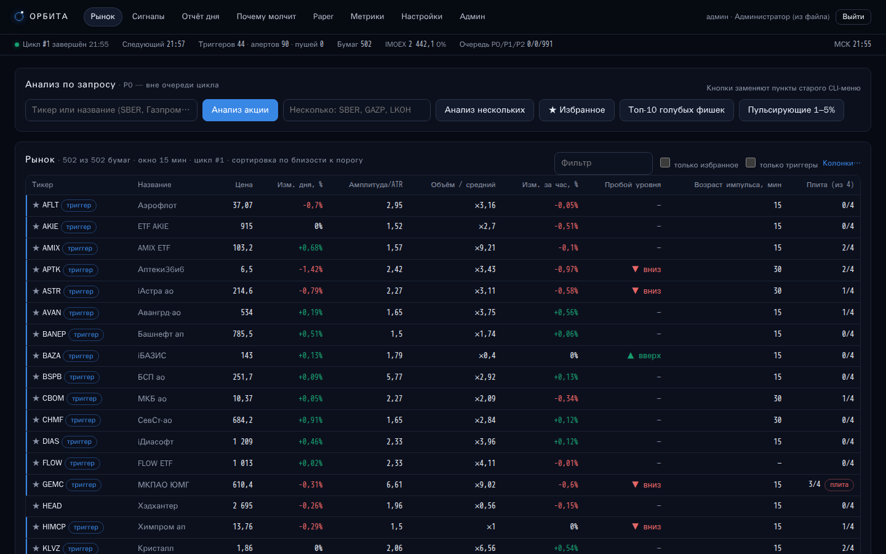

Доработка 1 (issue #3), демо-сервер ночью — сканер на паузе (23:50–07:00 МСК):

| | |
|---|---|
| 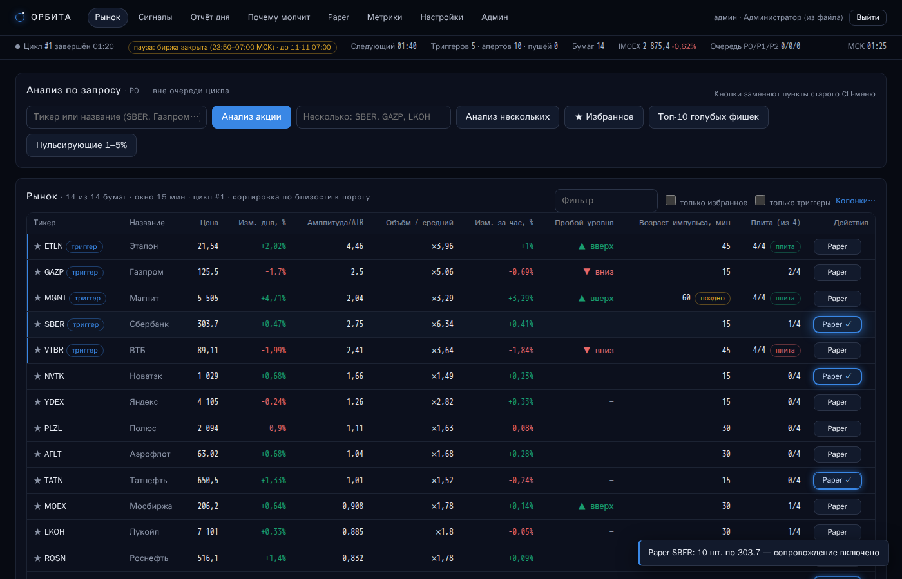 | 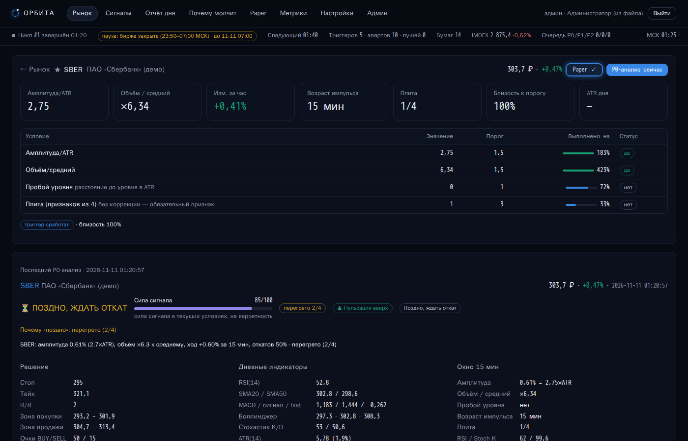 |
| 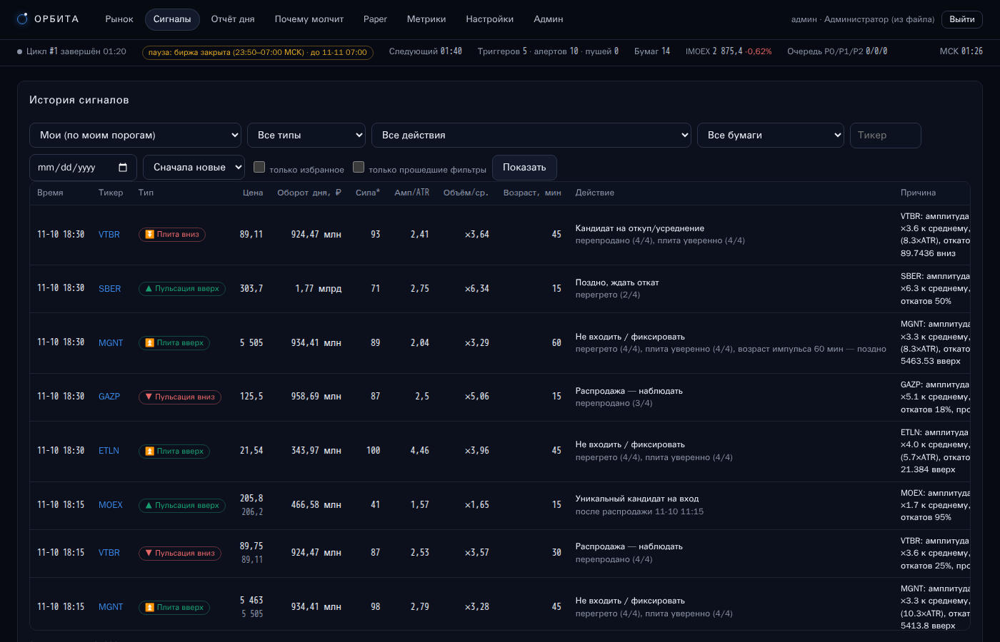 | 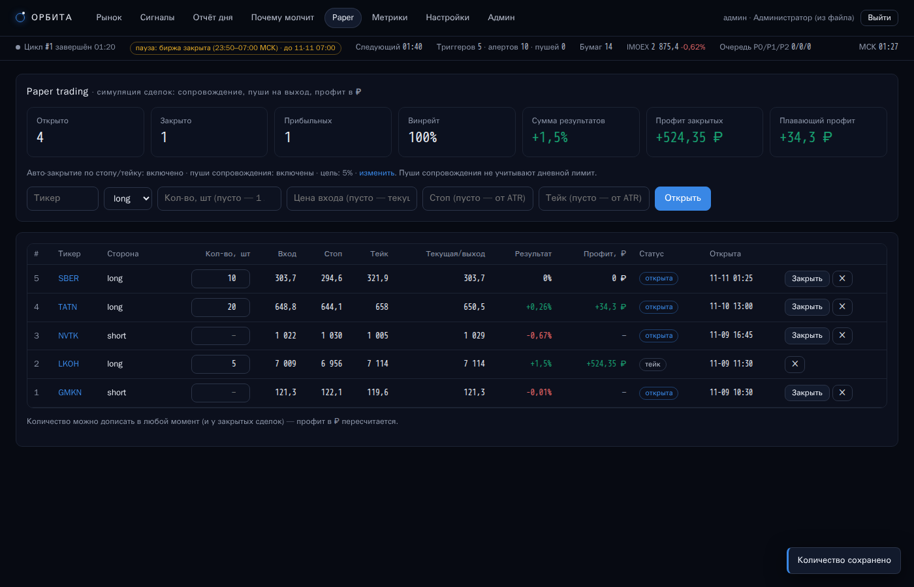 |
| 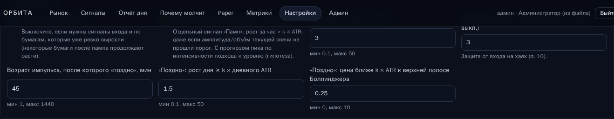 | 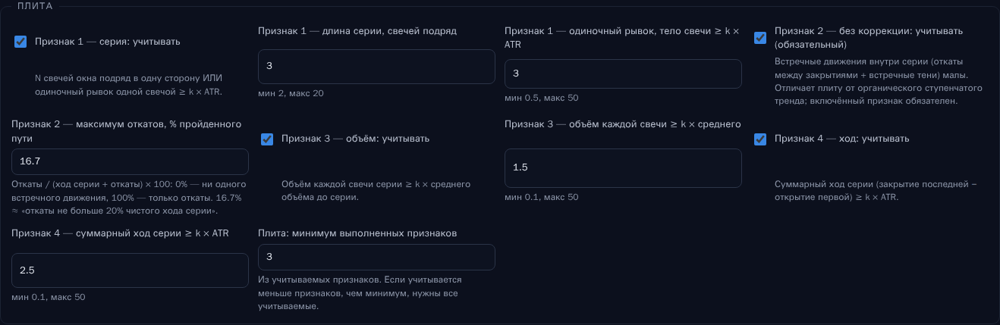 |
| 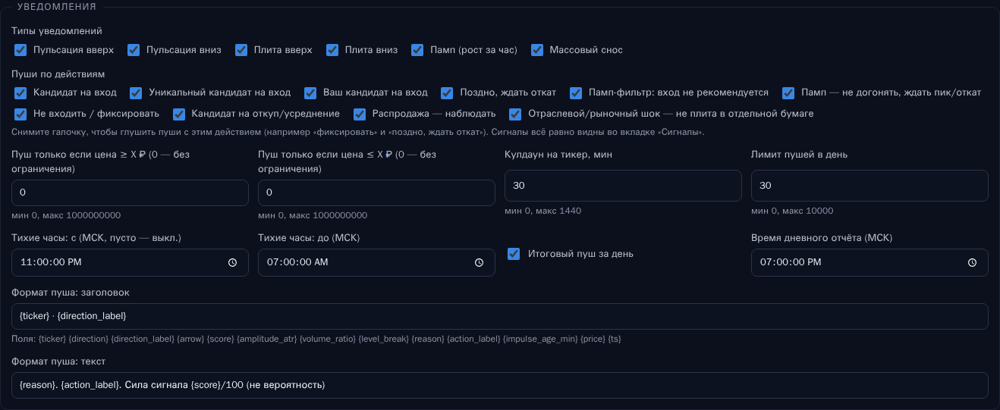 | 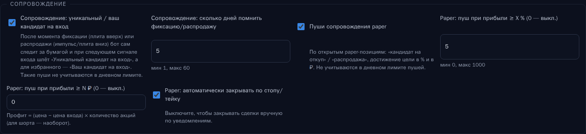 |
| 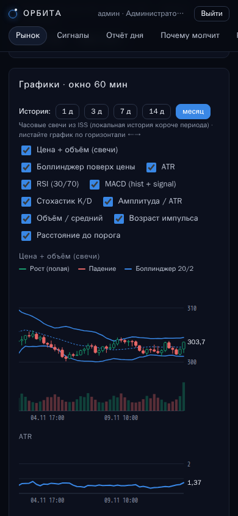 | 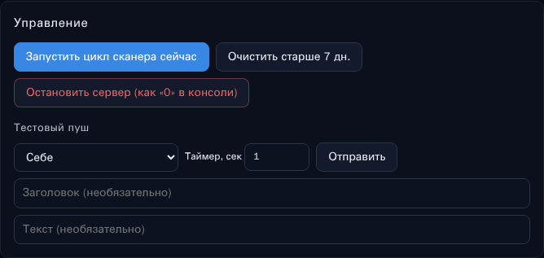 |

Доработка 2 (issue #5):

| | |
|---|---|
| 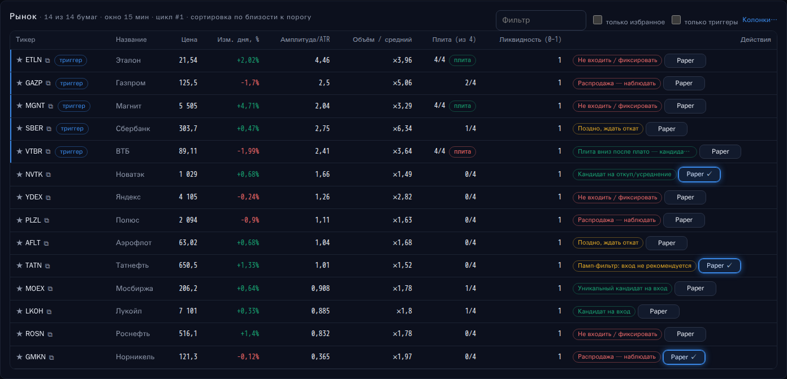 | 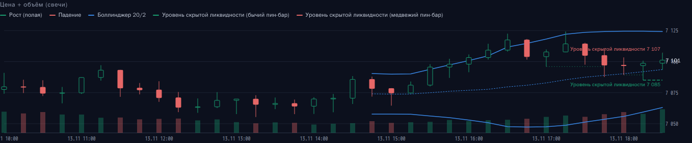 |
| 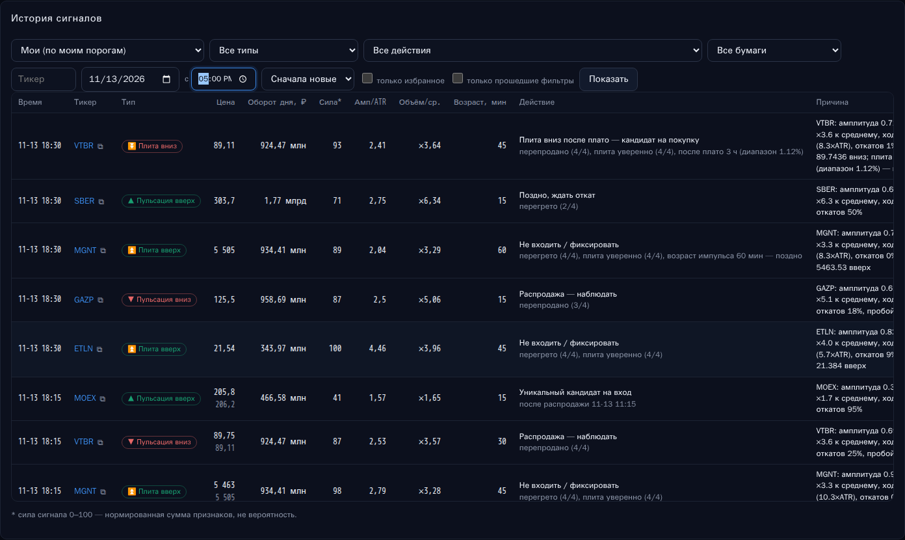 | 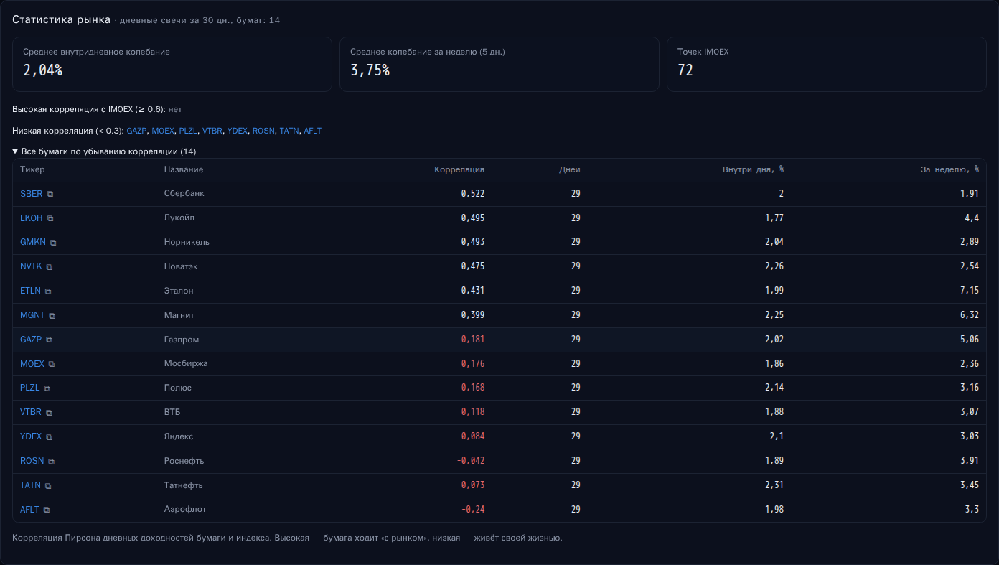 |
| 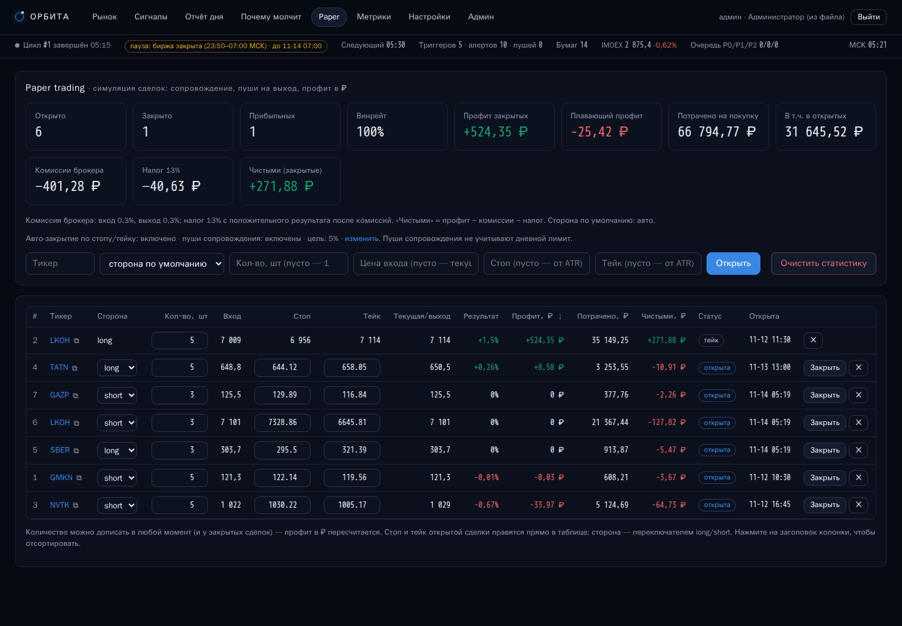 |  |
| 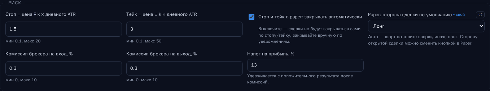 | 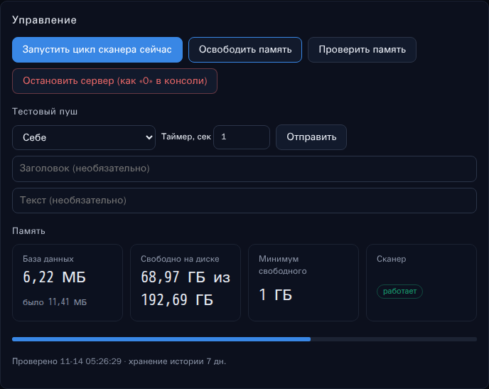 |

## Структура

```
start.py              единая точка запуска (сайт + сканер), остановка «0»
app/moex.py           клиент ISS MOEX (батчи, пагинация, стакан)
app/scheduler.py      token bucket, PriorityQueue P0/P1/P2, retry, TTL-кэш, метрики
app/scanner.py        цикл сканера, P0-анализ, доставка алертов, отчёт, paper
app/analysis.py       снапшот окна, плита, памп-связка, вердикт «поздно»
app/indicators.py     ATR, RSI, SMA, MACD, Боллинджер, стохастик, пивоты
app/alerts.py         условия триггера, alert-объект, шаблоны пуша
app/push.py           VAPID, подписки, отправка Web Push
app/auth.py, db.py    ключи, сессии, SQLite-схема
app/web.py            FastAPI: API + раздача SPA/PWA
app/static/           SPA (HTML+JS без сборки), SVG-графики, sw.js, манифест
examples/             офлайн-демо и пример ETLN
docs/GUIDE.md         руководство: функции, характеристики, триггеры, учебник
docs/DEPLOY.md        перенос на сервер (systemd, nginx, HTTPS)
```
