# trading_bot_v0.2
Помощник для решений с акциями на московской бирже

**Орбита** — сайт-дашборд в стиле космического минимализма с асинхронным
бэкэнд-сканером всех акций MOEX (режим TQBR), пуш-уведомлениями через браузер
(PWA + service worker + VAPID), анти-памп фильтром, детектором «плиты»,
журналом «почему молчит» и paper trading. Один процесс asyncio: сканер +
планировщик запросов + FastAPI/uvicorn + SQLite.

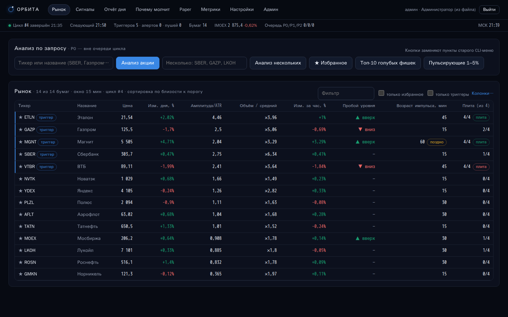

## Быстрый старт

```bash
python -m venv .venv && . .venv/bin/activate      # Windows: .venv\Scripts\activate
pip install -r requirements.txt
python start.py
```

Скрипт поднимает всё сразу — сайт, сканер, планировщик и БД — и печатает:

```
================================================================
  Дашборд:      http://127.0.0.1:8000
  Ключ админа:  admin-XXXX-XXXX-XXXX-XXXX  (создан сейчас)
  Файл ключа:   config/admin_key.txt
  База:         data/trading_bot.sqlite3
  Пуши (VAPID): готовы
  Сканер MOEX:  включён, 1 запрос/с
  Остановка:    введите 0 и Enter (или Ctrl+C)
================================================================
```

* Откройте адрес дашборда и войдите **ключом админа**.
* **Остановка** — ввести `0` и Enter в консоли (или Ctrl+C, или кнопка
  «Остановить сервер» в админке).

Нужен Python 3.10+.

### Демо без биржи

```bash
python examples/demo_server.py      # http://127.0.0.1:8000, остановка — «0»
```

Демо прогоняет настоящий конвейер сканера на детерминированных синтетических
данных (это **не** реальные котировки): неделя минутных свечей по 14 бумагам,
импульсы вверх/вниз, плита, «поздний» рост как у ETLN из issue. Демо-база и ключ
лежат отдельно — `data-demo/` и `config-demo/`. Все скриншоты ниже сняты с демо.

`python examples/etln_verdict.py` воспроизводит тест-кейс ETLN из п. 16: старый
скоринг говорит «ПОКУПАТЬ», а с фильтром выходит «ПОЗДНО, ЖДАТЬ ОТКАТ».

## Доступ: ключи-пароли

* **Админ** входит ключом из файла `config/admin_key.txt`. Если файла нет, при
  первом запуске он создаётся со случайным ключом. Ключ можно заменить вручную
  (первая непустая строка файла) — подхватится после перезапуска.
* Во вкладке **«Админ»** админ генерирует ключи для пользователей, меняет
  метку, **деактивирует/активирует** и удаляет их.
  * Деактивация сразу гасит сессии пользователя.
  * Ключ админа отключить нельзя.
* Ключи хранятся только как хэш (SHA-256) в таблице `access_keys`: роль,
  статус, подсказка (последние 4 символа), время последнего входа.
  Полный ключ показывается один раз — при создании.
* Пользователь вводит свой ключ на странице входа и попадает в личный кабинет.
  Сессия — httpOnly cookie на 30 дней.

## Что умеет

| Вкладка | Что внутри |
|---|---|
| **Рынок** | Таблица всех акций: цена, изменение дня, амплитуда/ATR, объём к среднему, изменение за час, пробой уровня, возраст импульса, признаки плиты, RSI и др. Набор колонок настраивается; сортировка — по близости к порогу. Кнопки «Анализ акции», «Анализ нескольких», «Избранное», «Топ-10 голубых фишек», «Пульсирующие 1–5%» — замена старого CLI-меню; они ставят задачу в очередь с приоритетом P0. |
| **Карточка тикера** | Все метрики и P0-анализ: вердикт, сила сигнала (не вероятность), стоп/тейк, R/R, зоны, RSI, SMA20/50, MACD, Боллинджер, стохастик, ATR, пивоты, недельный тренд, стакан. Графики: свечи+объём+Боллинджер, ATR, RSI 30/70, MACD, стохастик K/D, амплитуда/ATR, volume_ratio, возраст импульса, расстояние до порога. |
| **Сигналы** | История сигналов: время, тикер, направление, причина в цифрах, сила, действие. |
| **Отчёт дня** | Топ-3 вверх и вниз с причинами и метриками; пуш в 19:00 МСК (время настраивается); отраслевой/массовый снос. |
| **Почему молчит** | Журнал решений по каждому тикеру за цикл: какое условие не прошло и сколько не хватило, сортировка по близости к порогу. |
| **Paper** | Виртуальные входы по алерту: цена, стоп, тейк, автозакрытие по стопу/тейку, статистика. |
| **Метрики** | Планировщик: очередь P0/P1/P2, запросов/с, среднее время ответа, 429 за час, отставание P1. Плюс графики метрик по всем тикерам. |
| **Настройки** | Пороги сигнала, памп-фильтр, плита, риск, уведомления, формат пуша, колонки и графики. Подписка устройства на пуши. |
| **Админ** | Ключи пользователей, глобальные настройки (интервал цикла и т. п.), тестовый пуш с таймером (по умолчанию 1 с), запуск цикла, остановка сервера. |

### Сканер и планировщик (п. 1, 17, 21, 27)

* **Обход всех бумаг TQBR** с ценой. Один на весь процесс token bucket —
  1 запрос/с (`TB_RPS`), через него идут все запросы к ISS.
* **Одна `asyncio.PriorityQueue`** на три уровня:
  * **P0** — детали по сработавшему тикеру и по кнопкам: дневные свечи,
    индикаторы, стакан;
  * **P1** — хвост минутных свечей по всем бумагам (`from=<последняя свеча>`);
  * **P2** — фон: дневной ATR, отчёт.

  Пока в очереди есть P0, P1 и P2 ждут.
* **Батчинг:** список бумаг и котировки — одним запросом на всю доску; индекс —
  отдельным запросом.
* **Retry/backoff** на 429, 5xx и сетевые ошибки: задача возвращается в очередь
  с тем же приоритетом.
* **TTL-кэш:** свечи — до следующей свечи, список бумаг — сутки, индекс — минута.
* **Интервал цикла** задаёт админ, минимум 15 минут.
* **Индикаторы** (RSI, MACD, Боллинджер, стохастик, пивоты) считаются только на
  P0 — для тикера, прошедшего триггер.
* **Стакан** запрашивается только на P0. Без платной подписки ISS отдаёт HTML
  вместо стакана — сканер это видит и больше стакан не запрашивает. Плита
  детектируется по свечам и объёму.
* **Холодный старт:** если сервер запущен до открытия сессии, сканер берёт
  прошлую сессию (`PREVDATE`), чтобы таблица не была пустой.

### Сигнал, фильтры, уведомления (п. 6, 7, 10, 11, 13, 15, 18, 22–25)

* **Пороги нормированы на ATR** (п. 13). Амплитуда — это `амплитуда свечи / ATR`,
  с диапазоном min…max. Плюс объёмный множитель и пробой локального уровня за
  окно.
* **Анти-памп — связка из четырёх признаков:**
  1. рост за час > k×ATR;
  2. RSI > 70;
  3. цена выше верхней полосы Боллинджера;
  4. аномальный объём.

  Два признака из четырёх — метка «перегрето», три — пуш на покупку глушится.
  Отдельно задаются «длина импульса» и «порог одиночного рывка» (п. 7).
  Бумаги, выросшие за час больше X%, исключаются (п. 10).
* **Детектор плиты** (п. 22). Четыре признака:
  1. N свечей подряд в одну сторону;
  2. откаты внутри серии меньше m% хода (обязательный признак);
  3. объём каждой свечи > k×среднего;
  4. ход > k₂×ATR.

  Три признака из четырёх — «плита», четыре — уверенный сигнал.
  * **Плита вверх** → «не входить / фиксировать».
  * **Плита вниз** → «кандидат на откуп».
  * **Массовый снос:** 5+ бумаг в одну сторону в одном окне.
* **Возраст импульса** (п. 25) — `impulse_age_min`. Импульс старше порога
  получает метку «поздно, ждать откат», пуш на вход не уходит.
* **Единый alert-объект** (п. 18): `ticker, ts, direction, score, amplitude_atr,
  volume_ratio, level_break, impulse_age_min, reason`. Из него собираются пуш,
  строка истории и дневной топ-3.
  * Типы алертов: `up_pulse`, `down_pulse`, `up_plate`, `down_plate`,
    `sector_dump` — пользователь выбирает, какие получать.
  * Формат пуша — шаблон с подстановками (`{ticker}`, `{reason}`, `{score}`,
    `{amplitude_atr}` …) с предпросмотром. Пользователь задаёт свой, админ — по
    умолчанию для всех.
* **Анти-спам:** кулдаун на тикер (30 мин), лимит пушей в день, тихие часы.
* **«Сила сигнала»** везде подписана как сила в текущих условиях, а не
  вероятность.

### Пуш-уведомления (п. 5)

1. Пользователь жмёт «Подписать это устройство» в «Настройках»; браузер спрашивает разрешение.
2. Браузер отдаёт subscription (`endpoint`, `p256dh`, `auth`).
3. Subscription сохраняется в таблице `push_subscriptions` за его ключом.

* **VAPID-пара** генерируется один раз — `config/vapid_private.pem`.
* **Сервис-воркер** показывает пуши и при закрытой вкладке. Сайт ставится на
  домашний экран как PWA (Chrome на Android: «Установить приложение»).
* **Нужен защищённый контекст.** `http://localhost` / `http://127.0.0.1`
  подходят для локальной проверки. С телефона или из сети — только **HTTPS**,
  см. [docs/DEPLOY.md](docs/DEPLOY.md).
* **Админ: «Тестовый пуш»** — себе, конкретному пользователю или всем, с
  таймером (по умолчанию 1 с). Настраивается в админке.

### Данные

* **SQLite** `data/trading_bot.sqlite3`.
* **Таблицы:**
  * `access_keys`, `sessions` — ключи и сессии;
  * `push_subscriptions`;
  * `settings`;
  * `securities`, `candles`;
  * `snapshots`, `metrics` — метрики в формате `ticker, ts, metric, value`;
  * `alerts`;
  * `decisions` — журнал «почему молчит»;
  * `daily_reports`;
  * `paper_trades`;
  * `favorites`.
* **Срок хранения** свечей, метрик и журнала — 7 дней, настраивается.
* База общая для всех пользователей: к бирже ходит только сканер.

## Настройки запуска (переменные окружения)

| Переменная | По умолчанию | Назначение |
|---|---|---|
| `TB_HOST` | `127.0.0.1` | Адрес сервера (`0.0.0.0` — доступ из сети) |
| `TB_PORT` | `8000` | Порт |
| `TB_SCANNER` | `1` | `0` — только сайт, без запросов к MOEX |
| `TB_RPS` | `1.0` | Лимит запросов к ISS в секунду |
| `TB_DATA_DIR` | `./data` | Каталог базы |
| `TB_CONFIG_DIR` | `./config` | Каталог ключа админа и VAPID |
| `TB_VAPID_SUBJECT` | `mailto:admin@localhost` | Контакт для push-сервисов (укажите свой) |
| `TB_ISS_URL` | `https://iss.moex.com/iss` | Адрес ISS |

Пороги, интервал цикла, время отчёта и прочее меняются на сайте: глобально —
в админке, лично — в «Настройках».

`config/` и `data/` в git не попадают (`.gitignore`).

## Тесты

```bash
pip install -r requirements-dev.txt
pytest
```

Тесты идут без сети: на фейковом ISS и фейковом пуше. Покрыты:

* индикаторы;
* анализ: ATR-нормировка, плита, памп-связка, кейс ETLN;
* алерты и анти-спам;
* планировщик: приоритеты, bucket, retry, кэш;
* полный цикл сканера и холодный старт;
* HTTP API: ключи, роли, настройки, пуш с таймером, PWA;
* демо-данные.

Живая проверка клиента ISS (≈15 запросов):
`python experiments/live_iss_smoke.py SBER`.

## Скриншоты

| | |
|---|---|
| 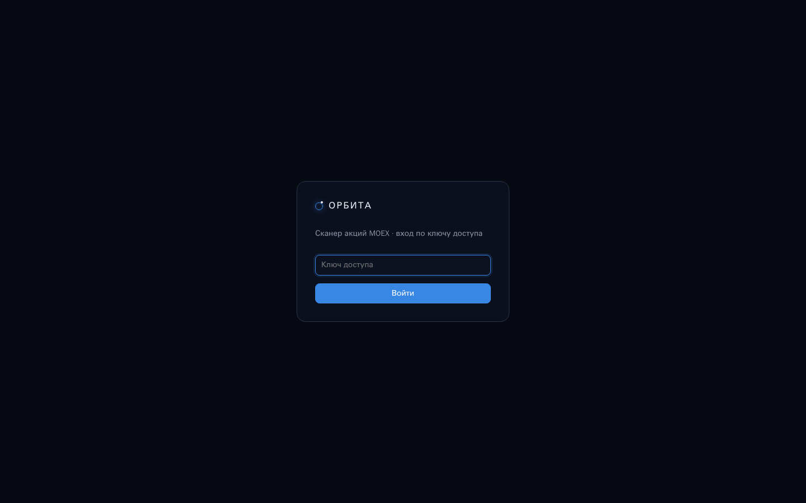 | 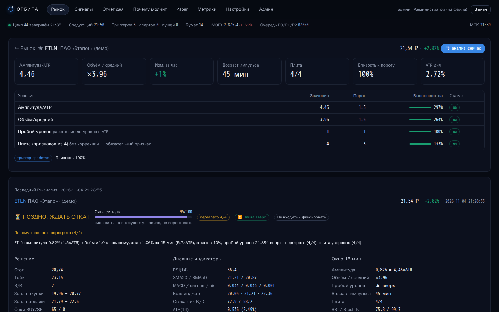 |
| 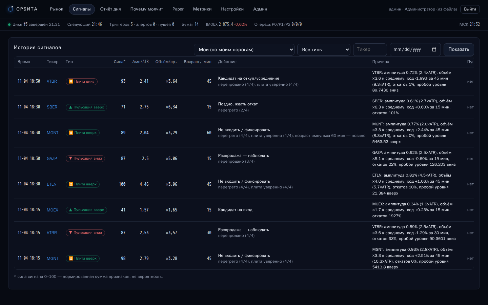 | 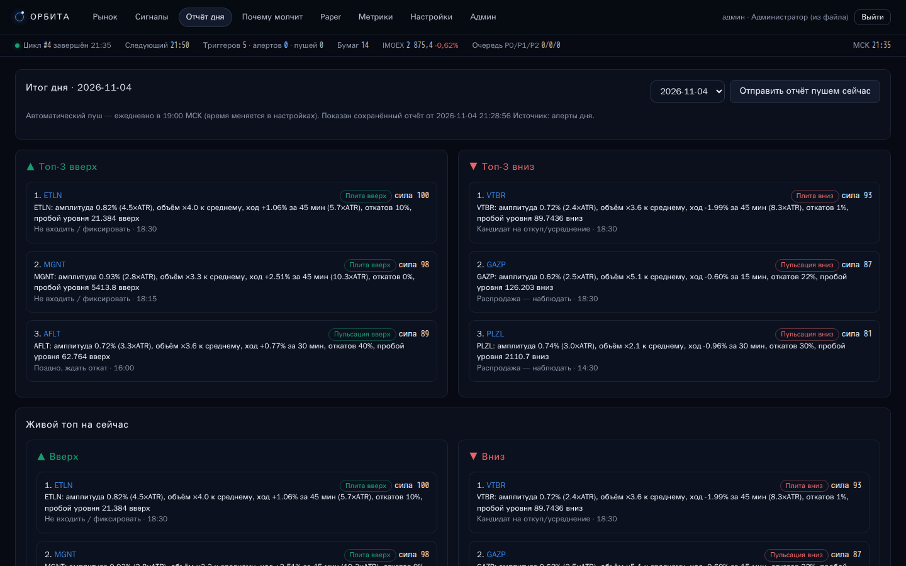 |
| 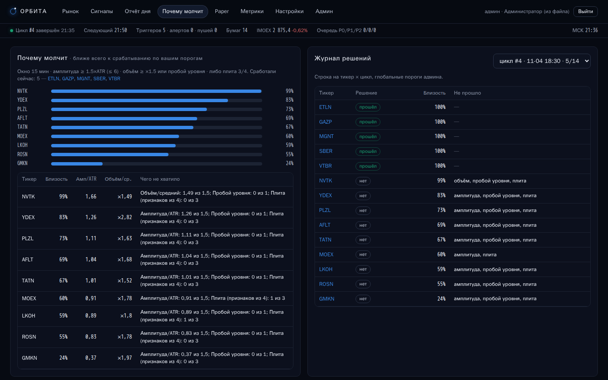 | 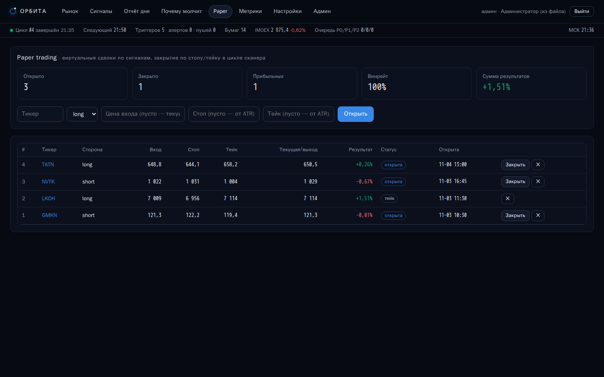 |
| 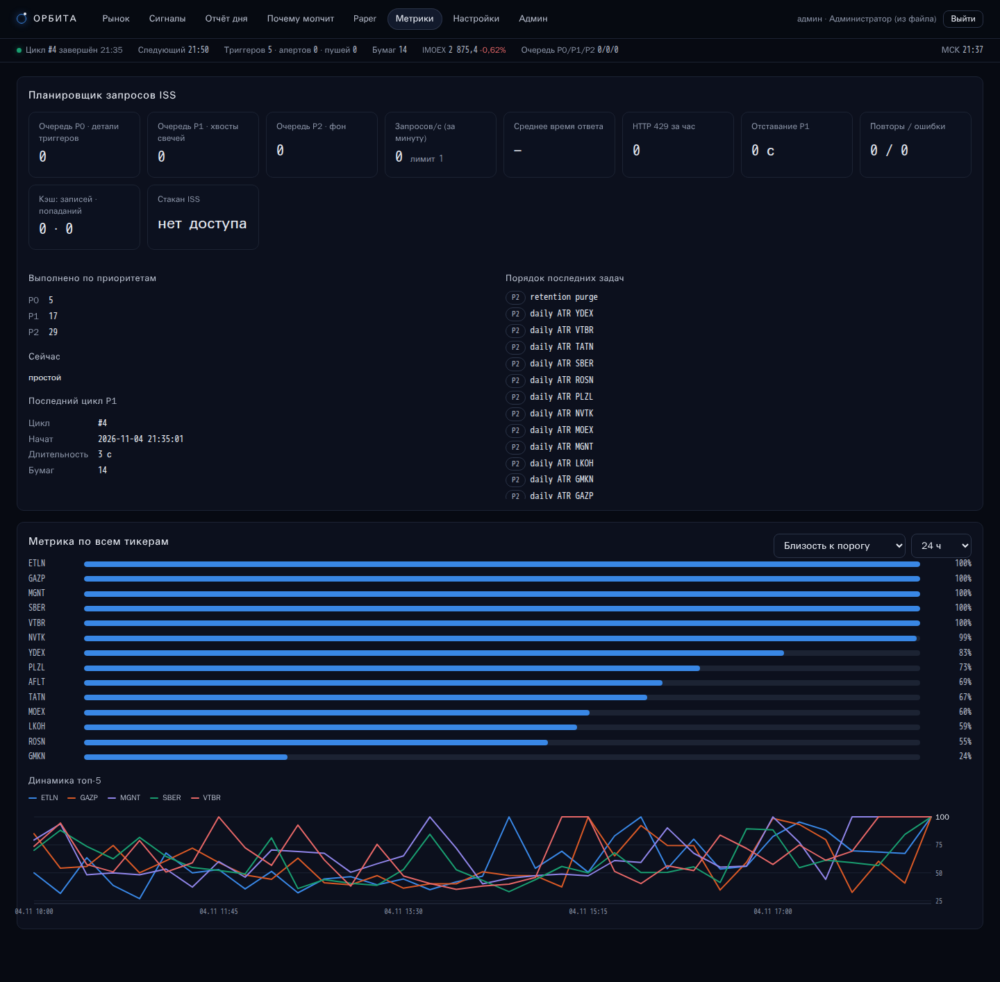 | 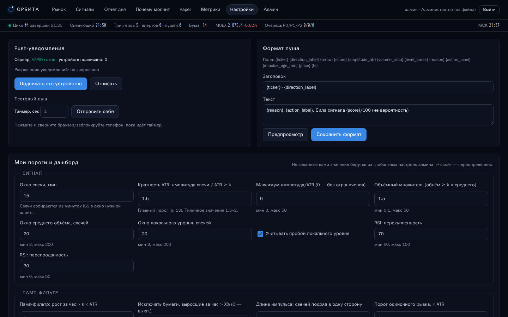 |
| 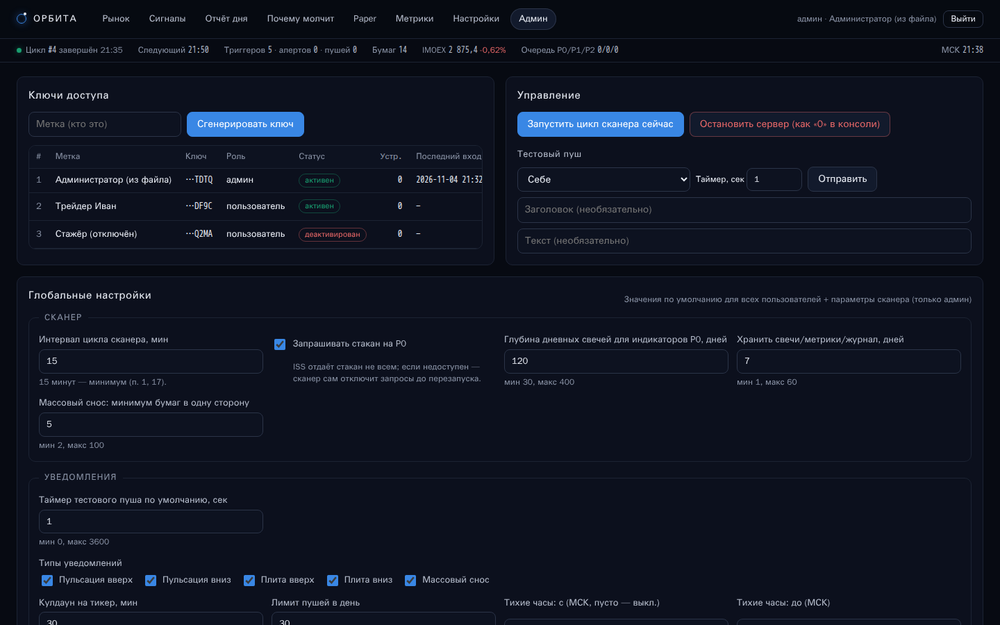 | 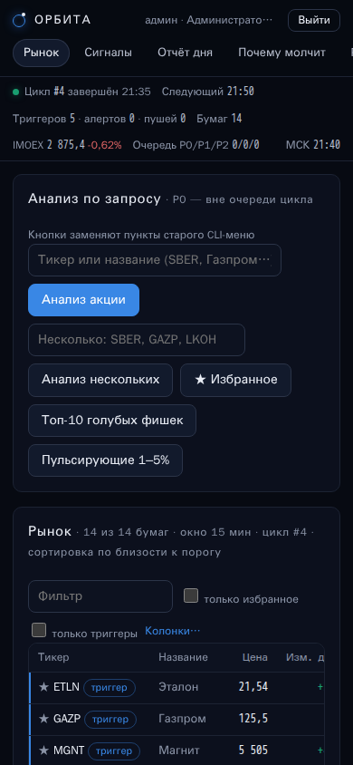 |

## Структура

```
start.py              единая точка запуска (сайт + сканер), остановка «0»
app/moex.py           клиент ISS MOEX (батчи, пагинация, стакан)
app/scheduler.py      token bucket, PriorityQueue P0/P1/P2, retry, TTL-кэш, метрики
app/scanner.py        цикл сканера, P0-анализ, доставка алертов, отчёт, paper
app/analysis.py       снапшот окна, плита, памп-связка, вердикт «поздно»
app/indicators.py     ATR, RSI, SMA, MACD, Боллинджер, стохастик, пивоты
app/alerts.py         условия триггера, alert-объект, шаблоны пуша
app/push.py           VAPID, подписки, отправка Web Push
app/auth.py, db.py    ключи, сессии, SQLite-схема
app/web.py            FastAPI: API + раздача SPA/PWA
app/static/           SPA (HTML+JS без сборки), SVG-графики, sw.js, манифест
examples/             офлайн-демо и пример ETLN
docs/DEPLOY.md        перенос на сервер (systemd, nginx, HTTPS)
```
